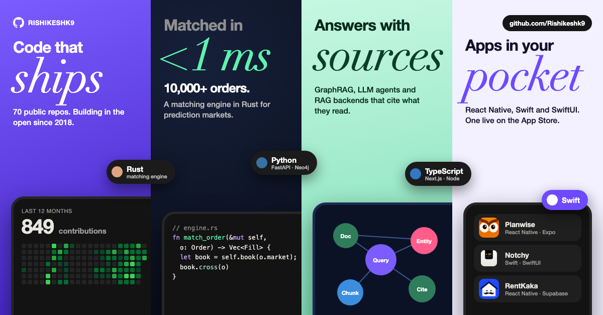

  

## Hi, I'm Rushikesh 👋

Senior full stack and AI engineer in Dubai with 7+ years of taking products from first idea to live production.
I build React and Next.js frontends, Python (FastAPI, Django, Flask) and Node.js backends, and production RAG and LLM agent systems.

- 🧠 Building **Verea**, a multi-tenant AI assistant that answers teams on WhatsApp from their own documents and acts in their CRM (FastAPI, Agno, PostgreSQL + pgvector, Hono gateway).
- 📈 Built the real-time trading web app and event-driven settlement services for **Outcome**, a live prediction market.
- 📱 Shipped **Planwise**, an AI day planner live on the App Store.
- 🏗️ Former CTO (Mintflick) and founder (Supersapiens Devlab): 50+ products delivered for clients in 12 countries.
- 🌍 Open to senior full stack, backend and AI engineering roles in the UAE, UK and remote.

## Featured work

| Project | What it is | Stack |
|---|---|---|
| [**GraphRAG**](https://github.com/Rishikeshk9/graphrag-assessment) | Local-first GraphRAG app: hierarchical chunking, typed entity graph in Neo4j, grounded answers with citations and a live graph inspector. [Live demo](https://ragchat.rushikeshkardile.com/) · [Video](https://youtu.be/gSqgwvoNEIs) | Python, FastAPI, Neo4j, Qdrant, Ollama, React |
| [**Planwise**](https://day-planner-blue.vercel.app) | AI day planner for iPhone and Android, live on the App Store, with sign-in, subscriptions and WhatsApp reminders. | React Native, TypeScript, Node.js |
| **Notchy** | macOS notch companion with clock, weather and Claude-powered screen explanations, hidden from screen capture. | Swift, SwiftUI |
| [**RentKaka**](https://rentkaka.in) | Rent management for landlords running rooms, PGs and hostels: tenants, leases, rent, electricity bills and complaints. | Expo (React Native), TypeScript, Supabase |
| [**Cactus**](https://github.com/Rishikeshk9/cactus) | Decentralised AI inference protocol: orchestrator nodes and routing servers that run AI jobs across a GPU network. | Rust, Python, Move |
| [**MantleSwap**](https://github.com/Rishikeshk9/MantleSwap) | Uniswap V2-style DEX with a governance token on the Mantle L2 network. [Video](https://youtu.be/KRTiznI6ZNA) | Solidity, TypeScript, React |

## Tech stack

**Frontend:** React, Next.js, TypeScript, Tailwind CSS, TanStack Query, React Native
**Backend:** Python (FastAPI, Django, DRF, Flask), Node.js, NestJS, Hono, REST, WebSockets
**AI:** RAG, LLM agents (Agno), pgvector, Qdrant, Neo4j, Ollama, OpenAI and Claude APIs
**Data:** PostgreSQL, Redis, Celery, MongoDB
**Cloud and DevOps:** AWS (ECS, ECR, Lambda), Docker, Kubernetes, Helm, CI/CD, Vercel
**Web3:** Solidity, EVM, account abstraction (EIP-4337), Rust

## Contact

[LinkedIn](https://www.linkedin.com/in/rushikeshkardile) · [Email](mailto:rushikeshkardile9@gmail.com)
